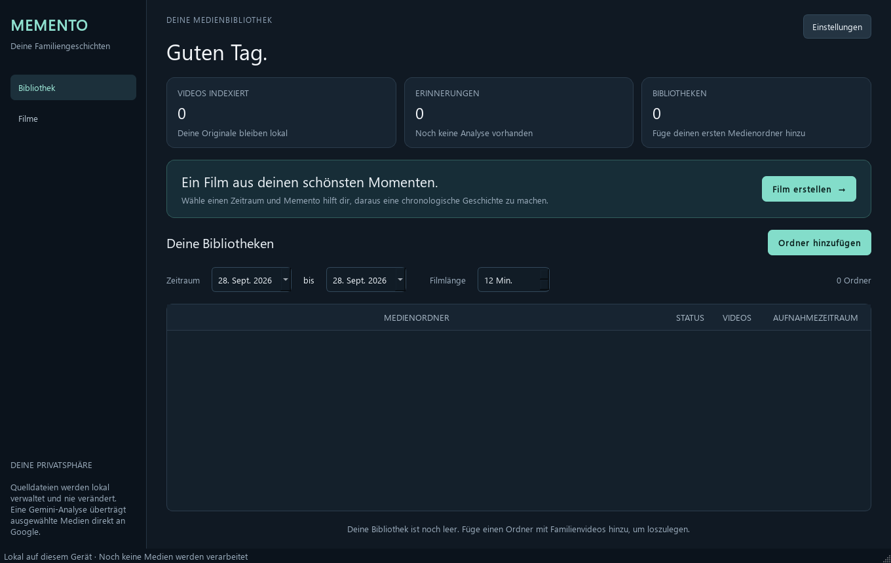
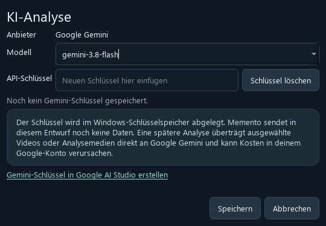

# Memento v2

Geführter Projektworkflow als getrennte Version. Die bisherige Anwendung in `../Memento` bleibt unverändert.

## Neuer Ablauf

1. **Dashboard:** gespeicherte Projekte fortsetzen und fertige Filme öffnen.
2. **Film anlegen:** Name, Zielzeit und optionalen Gemini-Prompt festlegen.
3. **Material:** Projektordner hinzufügen, indexieren und optional den Zeitraum eingrenzen.
4. **Analyse:** zuerst lokal mit OpenCV; anschließend ausgewählte Analysevideos ausdrücklich an Gemini senden.
5. **Schnitt & Musik:** standardmäßig zufällige Übergänge, alternativ klassisch und weitere Vorlagen; optional lokale Musikdatei und Suno-Prompt aus der Analyse.
6. **Film & Export:** Auswahl erzeugen, prüfen, bearbeiten und lokal als MP4 exportieren.

**Start unter Windows:** `./start_windows.ps1` oder nach dem Neubau `dist/Memento_v2/Memento_v2.exe`.

Eigene Daten: `%LOCALAPPDATA%/Memento_v2`. API-Schlüssel bitte in den v2-Einstellungen neu hinterlegen; sie werden getrennt im OS-Schlüsselspeicher verwaltet.

## Sprache / Language

Die Oberfläche unterstützt **Deutsch und Englisch**. Beim ersten Start wird auf
deutschsprachigen Systemen Deutsch gewählt, auf anderen Systemen Englisch.
Unter **Gemini-Einstellungen → Sprache / Language** lässt sich die Sprache
auswählen. Mit **Speichern** wird die Einstellung für den nächsten Start
übernommen; laufende Aufträge werden nicht unterbrochen.

The interface supports **English and German**. Open **Settings / Gemini →
Language / Sprache**, choose a language, save and restart the application.
The preference is stored locally. An explicit command-line choice applies only
to the current run:

```powershell
# Windows, im Ordner Memento_v2 / from Memento_v2
.venv\Scripts\python.exe -m memento.app --language en
.venv\Scripts\python.exe -m memento.app --language de
```

```bash
# Linux, from Memento_v2
.venv/bin/python -m memento.app --language en
```

Übersetzt werden Navigation, Dialoge, Tabellenüberschriften, Fortschrittsanzeigen
und bekannte Anwendungsmeldungen. Projektnamen, Dateipfade, eigene Prompts und
gespeicherte KI-Beschreibungen bleiben in ihrer ursprünglichen Sprache erhalten.
Die Sprachwahl verändert weder den Analyse-Cache noch bestehende Filmpläne und
startet keine zusätzliche KI-Anfrage. Neu erzeugte Suno-Prompts verwenden die
gewählte Oberflächensprache; bereits gespeicherte Prompts bleiben unverändert.

**Suno:** Den Prompt aus den analysierten Clips erzeugen, bei Bedarf bearbeiten und kopieren. Das Lied selbst in Suno erzeugen und herunterladen, dann über „Musikdatei auswählen“ importieren. Ohne gewählte Musik bleibt der Originalton erhalten. Es gibt keine Suno-API-Anbindung und keinen automatischen Download.

---

Übernommene Grundlagen und technische Hinweise:

Memento ist ein lokaler Desktop-Editor für Familienvideos. Die Bibliotheksansicht
kann Medien lokal indizieren, lokale Shots erkennen und Aufnahmen nach ihrem
gespeicherten Kalenderdatum filtern. Die Gemini-Analyse speichert semantische
Zeitbereiche dauerhaft. Daraus entstehen ein chronologischer, editierbarer
Filmplan und ein lokal gerenderter MP4-Film. Die Auswahlqualität muss noch an
echten Familienaufnahmen abgenommen werden.

## Voraussetzungen

Für den gebauten Windows-Entwicklungsstand ist keine Python-Installation nötig:
den vollständigen Ordner `dist/Memento_v2` verwenden und `Memento_v2.exe` darin starten.
Die Unterordner mit DLLs und Drittkomponenten gehören dazu. Dieser lokale Build
ist noch keine öffentlich freigegebene kommerzielle Auslieferung.

Für Entwicklung und Neubau:

- Windows oder Linux und Python 3.12
- Pakete aus `pyproject.toml`
- Sicherer Betriebssystem-Schlüsselspeicher: Windows-Anmeldeinformationsverwaltung
  oder unter Linux Secret Service (z. B. GNOME Keyring / KDE Wallet)

## Starten

Die Zielzeit ist ein Richtwert. Reichen die verfügbaren, nicht ausgeschlossenen
Momente nicht aus, wird das vorhandene Material verwendet und der Film kürzer.
Bei mehr Material wählt und kürzt die Planung passend zur Zielzeit. Auch Momente
unter zwei Sekunden können verwendet werden. Der Export setzt keine exakte
Übereinstimmung mit der Zielzeit voraus. Endet eine Quelle früher als in ihren
Metadaten angegeben, werden ihre verfügbaren lesbaren Videobilder übernommen;
der Exportfortschritt zeigt die kürzere Länge an.

Ein praktischer Testablauf mit Erwartungsliste und Prüfpunkten steht in
[`docs/first-test.md`](docs/first-test.md).

```powershell
python -m venv .venv
.venv\Scripts\python -m pip install -e ".[dev]"
.venv\Scripts\python -m memento.app
```

Der Entwicklungsstand wurde mit der lokalen Umgebung `Memento/.venv` begonnen.
Der Start kann alternativ direkt mit
`.venv\Scripts\python.exe -m memento.app` erfolgen.

### Linux

```bash
python3.12 -m venv .venv
.venv/bin/python -m pip install -e ".[dev]"
./start_linux.sh
```

Python 3.12 ist erforderlich; neuere System-Python-Versionen können parallel
installiert bleiben. Die Linux-Installation verwendet `pyproject.toml`, nicht
die Windows-Datei `requirements-runtime.lock`. Der Start ist alternativ mit
`.venv/bin/python -m memento.app` möglich. Ein Linux-Installationspaket ist
noch nicht vorhanden.

Für Gemini muss in derselben Desktop-/D-Bus-Sitzung ein entsperrter Secret-Service-
Schlüsselspeicher bereitstehen. Die Python-Abhängigkeit `SecretStorage` wird unter
Linux mitinstalliert. Ein vorhandenes natives KWallet-/libsecret-Backend von
`keyring` wird ebenfalls unterstützt. Unsichere Datei-Backends werden abgewiesen;
ohne sicheren Schlüsselspeicher bleibt die lokale Anwendung nutzbar und die
Einstellungen zeigen einen Hinweis. Details zu Linux-Backends stehen in der
[keyring-Dokumentation](https://keyring.readthedocs.io/en/latest/).

Neue Linux-Bibliotheken liegen unter `${XDG_DATA_HOME:-~/.local/share}/Memento`.
Existiert dort noch keine Bibliothek, wird ein vorhandener älterer Bestand unter
`~/AppData/Local/Memento` weiterverwendet, ohne ihn zu verschieben.
`MEMENTO_DATA_DIR` hat weiterhin Vorrang; Qt-Einstellungen liegen dann ebenfalls
im gewählten Verzeichnis.

Gespeicherte Medienordner müssen beim Start nicht erreichbar sein. Die Tabelle
zeigt „Derzeit nicht zugreifbar“ und behält gespeicherte Videozahlen und
Aufnahmezeiträume. Die Zugriffsprüfung läuft außerhalb des UI-Prozesses und wird
nach fünf Sekunden pro Ordner abgebrochen. Nach dem Verbinden eines Laufwerks
oder einer Netzwerkfreigabe aktualisiert „Erreichbarkeit prüfen“ den Status.
Wiederhergestellter Zugriff sagt noch nichts über Änderungen am Medienbestand aus;
diese werden durch erneutes Indexieren erfasst.

## Windows-Paket bauen und prüfen

Für einen deutschen NSIS-Installer mit Startmenüeintrag und Deinstallation:

```powershell
.\build_installer.ps1
```

NSIS 3 muss installiert sein. Details und Prüfablauf stehen in
[`docs/installer.md`](docs/installer.md). Für das reine Verzeichnispaket:

```powershell
.\build_windows.ps1
```

Das Skript verwendet die getesteten Windows-Laufzeitversionen aus
`requirements-runtime.lock`, prüft die Testsuite und baut ein PyInstaller-
Verzeichnispaket. Danach startet es die EXE mit isoliertem Datenverzeichnis und
einem auf Windows-Systemprogramme begrenzten `PATH`. Der Funktionstest erzeugt
seine Videos selbst und prüft Import, Aufnahmezeit, lokale Analyse, gespeicherte
Testsemantik, Filmplanung, Projektdatei, FFmpeg-Export und ein tatsächlich
decodiertes Qt-Vorschaubild. Er prüft außerdem die neue Zeitraumtabelle und
decodiert die erwartete Bildanzahl des Testexports mit Ton (höchstens ein Bild
Rundungsabweichung). Der Bericht
nennt die tatsächlich gebündelten Planungs-, lokalen Analyse- und Renderprofile.
Er erstellt außerdem eine Bibliothekssicherung und
stellt einen absichtlich geänderten Testwert über den Wiederherstellungsdialog
wieder her. Eine eigene temporäre Windows-Vault-Testkennung
wird geschrieben, gelesen und entfernt; der Gemini-Schlüssel wird nicht gelesen.
Gemini-Anfragen finden dabei nicht statt.

Der Prüfbericht liegt unter `build/latest-smoke-report.json`. Im Paket stehen
Quell-/EXE-Prüfsummen in `build-info.json` und Drittkomponenten mit gefundenen
Lizenzdateien unter `third-party`. Vor öffentlicher Weitergabe sind insbesondere
die noch offenen Lizenz-/Quellbereitstellungspflichten der gebündelten Komponenten
aus [`THIRD_PARTY_NOTICES.md`](THIRD_PARTY_NOTICES.md) abzuarbeiten.

Ein Paket lässt sich erneut prüfen mit:

```powershell
.venv\Scripts\python scripts/build_windows.py --verify-existing
```

Memento hält eine Betriebssystemsperre pro Bibliothek: Eine zweite Desktop-Instanz
derselben Bibliothek startet keine parallelen Jobs. Die Sperre wird auch nach einem
Prozessabbruch freigegeben. `MEMENTO_DATA_DIR` kann für getrennte Testbibliotheken
gesetzt werden; dann liegen auch die Qt-Einstellungen in diesem Verzeichnis.

## Aufnahmezeiten korrigieren

„Aufnahmen im Zeitraum“ zeigt die Treffer in Seiten zu je 200 Aufnahmen.
„Zurück“ und „Weiter“ blättern durch die gesamte Auswahl; die Trefferzahl und
Videos ohne bekanntes Datum bleiben sichtbar. Verglichen wird das gespeicherte
Kalenderdatum am Aufnahmeort, ohne Umrechnung in die Zeitzone des Computers.

„Aufnahmezeiten prüfen“ in der Seitenleiste zeigt auch Videos ohne Datum und
derzeit nicht erreichbare Dateien. Nach Dateiname oder Ordner suchen oder
„Unsichere oder fehlende Zeiten“ wählen, dann eine Aufnahme auswählen und
Datum/Uhrzeit korrigieren. Der UTC-Abstand am Aufnahmeort ist optional, zum
Beispiel `+02:00`; ein leeres Feld bedeutet unbekannt und wird nicht aus der
Zeitzone des Computers ergänzt.

Die Korrektur wird als manuell bestätigt im lokalen Index gespeichert und bleibt
bei erneuter Indizierung sowie identischen Kopien erhalten. Video- und KI-Analyse
bleiben gültig. Neue Filmpläne verwenden den korrigierten Zeitpunkt; einen bereits
gespeicherten Film dafür neu planen. Originaldateien werden nicht geändert.
Der Dialog bearbeitet einzelne Aufnahmen; eine gemeinsame Zeitverschiebung für
mehrere Aufnahmen ist noch nicht vorhanden.

## Sicherung und Wiederherstellung

„Sicherung und Wiederherstellung“ in der Seitenleiste öffnet die Verwaltung.
„Neue Sicherung erstellen“ schreibt eine eigenständige `.sqlite3`-Datei über die
SQLite-Backup-API, einschließlich bestätigter WAL-Daten. Vorhandene Dateien werden
nicht überschrieben. Gesichert werden Index, Analyseergebnisse und gespeicherte
Importaufträge; Originalvideos, Filmprojekte, Vorschaubilder und Schlüssel gehören
nicht dazu. Filmprojekte müssen separat aufbewahrt werden.

Zum Wiederherstellen eine Sicherung auswählen, die angezeigten Medien-/Analysezahlen
prüfen und den Austausch bestätigen. Memento bereitet eine Kopie vor, prüft
Integrität, Datenbeziehungen und Schema und migriert bei Bedarf nur diese Kopie.
Der aktuelle Stand wird vor dem Austausch unter `backups/restore-…/before.sqlite3`
erhalten. Auch eine unlesbare bisherige Datei samt WAL-/Journaldateien wird dort
als unveränderte Notfallkopie aufgehoben. Die ausgewählte Sicherung bleibt unverändert.

Ein Abbruch während der Vorbereitung lässt den bisherigen Index bestehen. Nach
dem Speichern des Austauschauftrags wird die Übernahme sicher abgeschlossen;
dieser letzte Schritt ist nicht mehr abbrechbar. Bei einem Prozessabsturz wird der
Auftrag beim nächsten Start abgeschlossen, bevor SQLite die Bibliothek öffnet.
Eine neu ausgewählte Sicherung kann einen beschädigten alten Auftrag ersetzen;
der alte Auftrag wird dabei archiviert.

Kann Memento seine Bibliothek nicht öffnen, bietet der Startdialog die
Wiederherstellung an. Alternativ öffnet folgender Aufruf die geprüfte Auswahl
im Wiederherstellungsdialog; er ersetzt den Index erst nach Bestätigung:

```powershell
.\Memento.exe --restore-backup "D:\Sicherungen\library.sqlite3"
```

Nach der Wiederherstellung werden bekannte Medienordner aus gespeicherten
Importaufträgen in die Ordnerliste übernommen. Fehlende Vorschaubilder können
mit „Alle Videos lokal analysieren“ neu erzeugt werden. Die Originalvideos müssen
weiterhin vorhanden oder über einen verifizierten identischen Standort indexiert sein.
Die Kopier-/Prüfphase startet nach einem Abbruch bei einem erneuten Versuch neu;
der bereits freigegebene abschließende Austausch wird nach Neustart fortgesetzt.

Das portable Programmpaket und private Anwendungsdaten sind getrennt. Das Entfernen
des Programmordners löscht weder die Medienbibliothek unter `%LOCALAPPDATA%\Memento`
noch den Schlüssel im Windows-Vault. Der Schlüssel lässt sich vor dem Entfernen
der Anwendung im Einstellungsdialog löschen. Der NSIS-Installer erhält diese
Anwendungsdaten ebenfalls; siehe [`docs/installer.md`](docs/installer.md).

## Erster GUI-Entwurf

Die Screenshots zeigen die aktuelle Bibliotheksansicht und den
Gemini-Einstellungsdialog:





## Gemini-Schlüssel

Der Einstellungsdialog speichert den Schlüssel über `keyring` im
Betriebssystem-Schlüsselspeicher. Memento schreibt ihn weder in die
Anwendungseinstellungen noch in Projektdateien oder Protokolle. Der Dialog
zeigt, welcher Schlüssel gespeichert ist, ohne ihn erneut auszulesen oder
anzuzeigen.

Das voreingestellte Modell ist laut aktueller [Gemini-Modellübersicht](https://ai.google.dev/gemini-api/docs/models)
stabil verfügbar. Die Modellkennung kann geändert werden.

Für die KI-Analyse einen Zeitraum wählen und „Erinnerungen analysieren“ öffnen.
Der Dialog zeigt Dateien, Quellbereiche, das Modell, die noch zu analysierende
Videodauer und die maximale Übertragungsmenge. Erst „An Google senden“ startet
die Verarbeitung. FFmpeg erzeugt lokal verkleinerte MP4-Abschnitte mit Ton und
entfernt Metadaten. Diese Abschnitte werden direkt an Google übertragen;
sichtbare und hörbare private Inhalte sind darin enthalten. Die Originale
bleiben unverändert. Temporäre Analysevideos werden nach Verarbeitung entfernt.
Googles Verarbeitung und Aufbewahrung richten sich nach deinen Kontobedingungen;
Memento behauptet keine sofortige Löschung der Anfragedaten bei Google.

Ergebnisse werden pro Quelle, Dateistand, Bereich, Modell und Analyseversion in
SQLite gespeichert. Ein erneuter Auftrag verwendet sie wieder. Unterbrochene
Aufträge lassen sich im Analysedialog auswählen und fortsetzen. Der Dialog zeigt
gespeicherte Momente, Begründungen, Fehler und Tokenzahlen erfolgreicher Antworten.
Diese Tokenzahlen sind keine vollständige Abrechnung; Gebühren für fehlgeschlagene
oder unterbrochene Anfragen sind möglich. Während eines laufenden Netzwerkaufrufs
kann der Abbruch erst nach Antwort oder Netzwerk-Timeout erfolgen. Der
Socket-Timeout beträgt 60 Sekunden und ist keine garantierte Gesamtlaufzeit.

„Maximale Anbieteraufrufe pro Start“ begrenzt die Anzahl der Gemini-Aufrufe nach
jedem Klick auf „An Google senden / Fortsetzen“. Voreingestellt sind 25; Fehler
und automatische Wiederholungen zählen mit, Cachetreffer nicht. Sobald das Limit
erreicht ist, stoppt der Auftrag vor dem nächsten Aufruf. Erfolgreiche Antworten
bleiben gespeichert. Erst ein erneuter ausdrücklicher Start erlaubt wieder die
eingestellte Anzahl Aufrufe. Die Einstellung kann zwischen den Starts geändert
werden. Angezeigt werden sowohl der gesamte offene Auftrag als auch das begrenzte
Übertragungsvolumen dieses Starts und die dauerhaft erfassten Aufrufversuche im
gewählten Auftrag. Das Aufruflimit ist kein Geldlimit und ersetzt nicht die
Kostenkontrolle im Google-Konto. Ein neuer Auftrag hat eine eigene Versuchszählung.

Die Bereichstabelle zeigt höchstens 100 Einträge pro Seite. Mit „Vorherige Bereiche“
und „Nächste Bereiche“ lassen sich auch große Aufträge vollständig prüfen.
Quellpfade, gespeicherte Antworten und Fehler werden gemeinsam je Seite aus der
lokalen Datenbank geladen. Der Seitenwechsel startet keine Analyse. Die angezeigte
Seite beschränkt die Übertragung nicht: Ein Start verarbeitet fehlende Bereiche
des gesamten ausgewählten Auftrags bis zum eingestellten Aufruflimit.

## Einen Film erstellen

1. Medienordner hinzufügen und indexieren. Danach „Alle Videos lokal analysieren“
   ausführen: Schnittgrenzen, Schärfe, Belichtung, Kamerabewegung und Bildsignaturen
   werden ohne Upload gespeichert. Die semantische Auswahl benötigt zusätzlich
   gespeicherte Gemini-Ergebnisse.
   Das lokale Analyseprofil v3 prüft vorzeitige Decoderabbrüche. Ältere lokale
   Analysen werden beim nächsten ausdrücklichen Analysestart neu berechnet;
   gespeicherte Gemini-Ergebnisse bleiben erhalten. Fehler einzelner Videos
   erscheinen unter „Fehler anzeigen“ und können über „Fortsetzen“ erneut
   verarbeitet werden. Eine gemeldete Decoderstörung bedeutet nicht zwingend,
   dass die Originaldatei beschädigt ist.
2. Gemini-Schlüssel in den Einstellungen hinterlegen und das Modell wählen.
3. Einen beliebigen Zeitraum wählen, „Erinnerungen analysieren“ öffnen und die
   angezeigten Uploadbereiche prüfen. „An Google senden“ startet die KI-Analyse.
4. Gewünschte Filmlänge einstellen, „Film erstellen“ und dann „Auswahl erzeugen“
   anklicken. Die Planung arbeitet ausschließlich auf dem lokalen Cache.
5. Ereignisse, Quellbereiche und Auswahlgründe prüfen. Ein ausgewähltes Segment
   kann mit Ton abgespielt, an seinen Grenzen geändert, entfernt oder verschoben werden.
   „Gesamten Film als Vorschau ansehen“ bereitet den aktuellen Schnitt lokal in
   640 × 360 mit 30 Bildern/s und Originalton vor. Mit „Pause / weiter“ und dem
   Schieberegler lässt sich der Film zusammenhängend prüfen. Diese Vorschau ist
   niedriger aufgelöst als der Export und benötigt keine KI-Anfrage.

   „Ereignisse und Zeitverteilung“ zeigt die tatsächliche Dauer und den Filmanteil
   jedes Ereignisses sowie ausgewählte und im Plan bekannte Momente. Nicht
   berücksichtigte Ereignisse bleiben mit null Sekunden sichtbar. Deaktivierte
   Segmente zählen nicht zur Ausgabe. Bei einem ausgewählten Ereignis werden
   noch fehlende erzwungene Momente, weiterhin enthaltene ausgeschlossene Momente
   und abweichende manuelle Schnittvorgaben angezeigt. Nicht zugeordnete historische
   Vorgaben erhalten einen gesonderten Hinweis. Die Übersicht liest nur den Filmplan;
   sie plant nicht neu und benötigt weder Medienzugriff noch KI-Aufrufe.
   Ereignisgewichte sind relative Wünsche für die nächste Neuplanung, keine
   garantierten Zeitbudgets. Bekannte Kandidaten können inzwischen fehlen oder
   sich überlappen.
6. Über „Momente ein-/ausschließen“ Vorgaben setzen oder die relative Bedeutung
   eines Ereignisses verändern. „Neu planen“ wendet diese Vorgaben an. Erzwungene
   Momente bleiben vollständig erhalten und können die Zielzeit überschreiten.

   Der Momentedialog funktioniert auch nach dem Öffnen gespeicherter Filmprojekte:
   Die Analyseergebnisse werden separat aus dem lokalen Cache geladen. Schnitte,
   Reihenfolge und Timeline bleiben dabei erhalten; es erfolgt keine KI-Anfrage.
   Historische Momente, die im aktuellen Analysebestand fehlen, bleiben als solche
   sichtbar. Ihre gespeicherten Vorgaben lassen sich entfernen, etwa um ein nicht
   mehr verfügbares erzwungenes Highlight vor der nächsten Neuplanung zu bereinigen.
   „Manuelle Schnittvorgabe … zurücksetzen“ entfernt die Vorgabe für die nächste
   Auswahl, ohne den aktuellen Schnitt zu ändern. „Abbrechen“ verwirft Änderungen
   im Momentedialog; „Vorgaben übernehmen“ speichert sie als rückgängig machbaren Schritt.
7. Filmpläne werden automatisch unter `%LOCALAPPDATA%\Memento\movies` gespeichert.
   Sie lassen sich als `.memento.json` auch separat sichern und wieder öffnen.
   Schnittänderungen verändern weder Originale noch Analyseergebnisse.
8. „Film lokal als MP4 exportieren“ wählen und einen neuen Dateinamen angeben.
   Die Ausgabe verwendet H.264/AAC, 1920 × 1080 und 30 Bilder/s, erhält den
   Originalton und ergänzt bei Videos ohne Ton Stille. Hochformat wird eingepasst.
   Vorhandene Videos werden nicht überschrieben. Anschließend lässt sich der Film
   im Standardplayer öffnen.

Im Filmfenster lassen sich die letzten 50 Änderungen mit „Rückgängig“ und
„Wiederholen“ oder Strg+Z / Strg+Y zurücknehmen beziehungsweise wiederherstellen.
Die Historie umfasst Schnittgrenzen, Entfernen, Reihenfolge, Titel, Ein-/Ausschlüsse,
Ereignisgewichte und neu erzeugte Auswahlen samt Zielzeit. Jeder wiederhergestellte
Stand wird automatisch in der aktuellen Filmprojektdatei gespeichert. Ein
Schreibfehler übernimmt die Änderung nicht; der vorherige Stand bleibt aktiv.
Neue Änderungen nach dem Rückgängigmachen verwerfen den Wiederholen-Zweig.
Die Historie gilt für die laufende Sitzung; das Öffnen eines Filmprojekts beginnt
eine neue Historie. Gespeichert bleibt der aktuelle Plan, keine dauerhafte
Versionssammlung. Medienbibliothek und KI-Analysen werden nicht kopiert oder geändert.

Ein abgebrochener Export lässt sich durch erneuten Export desselben Filmplans
fortsetzen. Fertige normalisierte Segmente bleiben unter
`%LOCALAPPDATA%\Memento\cache\renders` gespeichert; Quelle, Schnitt und
Exporteinstellungen müssen unverändert sein. Ein neuer Filmplan, ein anderer
Zeitraum oder eine andere Zielzeit erfordert keine erneute KI-Analyse.

Vor Abschluss prüft Memento den exportierten Film lokal auf lesbares Bild und
Ton sowie die erwartete Bildanzahl. Das benötigt zusätzliche Rechenzeit.
Zu kurze Bildfolgen werden als Fehler gemeldet und nicht als fertiger Film
veröffentlicht. Beschädigte Zwischensegmente werden beim erneuten Export
neu erzeugt; intakte Segmente bleiben wiederverwendbar. Das Renderprofil v2
verwendet ältere Zwischendateien aus Profil v1 nicht weiter. KI-Analysen und
Filmpläne bleiben davon unabhängig.

Die Ereigniserkennung verwendet derzeit zeitliche Abstände und sprachliche
Ähnlichkeit der Gemini-Beschreibungen. Sie ist eine nachvollziehbare Heuristik,
keine verifizierte Personen- oder Ereigniserkennung. Knappe Ereignisbudgets
können vorgeschlagene Bereiche kürzen; diese Schnittgrenzen werden gekennzeichnet.
Eine zu kurze Materialauswahl wird nicht durch Wiederholungen aufgefüllt.

Bei der Zeitverteilung zählt der stärkste geeignete Erinnerungsmoment eines
Ereignisses. Viele belanglose Zusatzaufnahmen werten einen wichtigen Moment
dadurch nicht ab. Verfügbares Material und deine Ereignisgewichte begrenzen
beziehungsweise verändern die Verteilung weiterhin. Bestehende Filmpläne
übernehmen diese Planungsänderung erst über „Neu planen“; eine neue KI-Analyse
ist dafür nicht nötig.

Für vollständige vorgeschlagene Momente sind Ereignisbudgets begrenzt flexibel:
Der Planer darf bis zu zwei Sekunden zusätzliche Zeit pro Auswahl übertragen,
höchstens ein Viertel des jeweiligen Ereignisbudgets. Insgesamt werden dafür
höchstens 15 Prozent der Zielzeit umverteilt. Die Zeit wird von anderen offenen
Ereignisbudgets abgezogen; für noch nicht vertretene Ereignisse bleibt deren
vorhandener Anteil bis zu zwei Sekunden reserviert. Die gesamte Zielzeit bleibt
eingehalten. Solche Entscheidungen stehen in den Auswahlgründen. Größere notwendige
Kürzungen bleiben möglich und werden weiterhin gekennzeichnet. Die vorgeschlagenen
Grenzen stammen aus der Analyse; automatische Sprach- oder Handlungsgrenzen sind
damit nicht nachgewiesen.

Eine unveränderte Filmvorschau wird in der Sitzung wiederverwendet. Nach Änderungen
am Filmplan wird sie beim nächsten Aufruf neu erstellt. Die Vorschau zeigt den
zum Erstellungszeitpunkt gerenderten Stand; Änderungen an Quelldateien erfordern
erneute Indizierung und Planung. Die Erstellung ist abbrechbar. Fertige Renderteile
bleiben im Rendercache für einen erneuten Versuch erhalten. Die fertigen
Vorschaufilme liegen separat unter `cache/previews/session-…` und werden beim
regulären Schließen des Filmfensters nach Freigabe der Wiedergabe entfernt.
Nach Prozessabbruch oder bei gesperrten Dateien können Cachedateien zurückbleiben.

Manuell übernommene Schnittgrenzen bleiben bei der Neuplanung exakt erhalten,
wenn der Moment ausgewählt wird. Ein solcher Bereich kann mehr Zeit als das
anfängliche Ereignisbudget bekommen, wird aber nicht automatisch gekürzt.
Passt er nicht vollständig in die verbleibende Zielzeit, kann er entfallen;
die Auswahlentscheidung nennt diesen Grund. Über „Erzwingen“ bleibt er auch
bei zu kurzer Zielzeit enthalten. Ereigniszuordnung und Ereignisgewichte folgen
weiter den ursprünglichen Analysezeiten, auch wenn ein Schnitt verschoben wird.
Die Reihenfolge des Films folgt den tatsächlich gewählten Quellanfängen.
Erweitert ein Schnitt den vorgeschlagenen Moment, erinnert ein Prüfhinweis daran,
dass dessen semantische Beschreibung für den ursprünglichen Bereich erstellt wurde.

Lokale Qualitätswerte wirken als kleine Präferenz: Ein wichtiger menschlicher
Moment darf trotz dunklem oder unscharfem Bild enthalten bleiben. Stark ähnliche
Bildstichproben verringern Wiederholungen, sind aber kein sicherer Duplikatnachweis.
Einfarbige oder zu wenige Stichproben werden dafür nicht verwendet. Nach einem
Update der lokalen Analyse kann sie erneut gestartet werden; gespeicherte
Gemini-Ergebnisse werden dadurch nicht verworfen. Ohne aktuelle lokale Messwerte
bleibt der Qualitätsanteil neutral.

Bildähnlichkeit wird auch zwischen verschiedenen Ereignissen berücksichtigt:
Eine visuell abweichende Alternative kann einen wiederholten Bildbereich ersetzen.
Dies bleibt eine weiche Auswahlpräferenz. Ähnliche Aufnahmen können wegen ihres
Erinnerungswerts, Tons oder ausdrücklicher Nutzervorgaben enthalten bleiben und
tragen dann einen Prüfhinweis. Beschreibungen wie „Familie spielt“ gelten dagegen
nicht allein deshalb an mehreren Tagen als derselbe Moment. Automatisch gekürzte
Bereiche liefern keinen Ähnlichkeitsbeleg aus den Bildstichproben ihrer ungekürzten
Kandidaten. Die Auswahlqualität bleibt an realen Aufnahmen zu prüfen.

## Schnittvorlagen

Im Filmfenster gibt es fünf Vorlagen: **Klassisch · Cut**, **Sanft · Crossfade**,
**Weich · Blurfade**, **Ruhig · Schwarzblende** und **Dynamisch · Zoom hinein**.
Vorlage und Übergangsdauer (0,1–2 Sekunden) wählen und „Vorlage übernehmen“
anklicken. Bei der ersten Auswahl wird die eingestellte Vorlage direkt übernommen.
Die Vorlage gilt einheitlich für alle aktiven Clipwechsel. Der Zoom ist ein
Übergang zwischen Clips, kein dauerhafter Zoom auf einzelne Aufnahmen. Blurfade
verwendet FFmpegs horizontale Unschärfeüberblendung.

Die gesamte Filmvorschau und der MP4-Export verwenden dieselbe Vorlage. Die
Einzelsegment-Vorschau spielt weiterhin das Original ab. Übergänge überlappen
benachbarte Bereiche und blenden deren Originalton weich ineinander; dadurch
verkürzt sich der Film. Die Übersicht zeigt die ungefähre Dauer mit Übergängen.
Bei kurzen Clips wird die Überlappung auf höchstens die Hälfte beider Nachbarn
gekürzt und auf ganze Ausgabebilder abgerundet/begrenzt. Sehr kurze Bereiche
können daher ohne Übergang verbunden werden. Die tatsächliche Dauer hängt auch
von den decodierbaren Bildern und der Bildrate ab. Bei Cut bleibt der bisherige
harte Schnitt einschließlich Originalton bestehen.

Vorlagen verändern weder Highlight-Auswahl noch manuelle Quellgrenzen und
benötigen keine KI-Anfrage. Sie bleiben bei Neuplanung erhalten, werden im
Filmprojekt gespeichert und unterstützen Rückgängig/Wiederholen. Alte Projekte
öffnen sich mit Cut. Nach einem Vorlagenwechsel die Filmvorschau erneut starten
oder einen neuen Export anlegen; bestehende MP4-Dateien bleiben erhalten.
Vorbereitete Quellclips sind zwischen Vorlagen wiederverwendbar. Die zusätzlichen
Überblendungen benötigen lokale Renderzeit und Cache-Speicher.

## Kopien, Umbenennungen und Inhaltsprüfung

Aufnahmezeiten werden aus FFprobe-Tags oder aus den strukturierten globalen und
Video-Tags des gebündelten FFmpeg gelesen. QuickTime-Aufnahmedatum und verfügbare
EXIF-Originalzeit mit Offset werden bevorzugt. Ungültige Angaben verdecken keine
gültigen Ersatzwerte. Fehlende Zeitzonen werden nicht ergänzt; reine Datumsangaben
und Dateisystemersatz erhalten geringere Konfidenz. EXIF wird berücksichtigt, wenn
das Medienwerkzeug diese Felder ausgibt; Memento enthält keinen eigenen vollständigen
EXIF-Binärparser. Die Konfidenzen sind Heuristiken, keine kalibrierten Wahrscheinlichkeiten.
Eine neue Metadatenversion wird beim nächsten Indexlauf nachgetragen, ohne bei
unverändertem verifiziertem Inhalt erneut zu hashen oder die KI-Analyse zu verwerfen.

Beim ersten Import liest Memento jedes Video vollständig und berechnet lokal
einen SHA-256-Hash. Bytegleiche Kopien erhalten dieselbe Medienidentität und
teilen sich vorhandene lokale und Gemini-Analysen, auch bei anderem Dateinamen
oder Änderungsdatum. Bereits indexierte Dateien ohne Hash werden beim nächsten
Import nachgetragen. Bei unverändertem Dateistand bleiben vorhandene Ergebnisse
und Kandidaten-IDs erhalten. Die vollständige Prüfung braucht zusätzliche Lesezeit;
Fortschritt und Abbruch sind im Import sichtbar.

Normale Folgescans überspringen bereits verifizierte, nach Größe und Änderungszeit
unveränderte Dateien. „Inhalte erneut prüfen“ erzwingt einen neuen Vollhash und
findet auch Änderungen mit identischen Dateiattributen. Diese Option wird im
Importauftrag gespeichert und gilt auch bei dessen Wiederaufnahme.

Nach Umbenennen oder Verschieben den neuen Medienordner indexieren. Filmpläne
mit gespeicherter Inhaltsidentität werden beim Export wiederverknüpft, wenn ein
indexierter Ersatz denselben Vollhash hat; Schnittgrenzen bleiben erhalten.
Der Renderer prüft verifizierte Quellen vor ihrer Verwendung vollständig.
Alte Filmpläne ohne Inhaltsidentität werden nicht anhand ähnlicher Dateinamen
automatisch verknüpft. Beim Ersetzen einer bereits verifizierten Datei durch
anderen Inhalt entstehen eine neue Identität und ein eigener Analysebedarf.

## Projektstand

Die schrittweise Planung steht in [`Todo.md`](Todo.md). Die bestehende
UltraCut-Anwendung liegt im Schwesterordner `../Prototype` und wird nicht als
Laufzeitabhängigkeit eingebunden.

Aktuelle Umsetzung, Grenzen und offene Abnahmeschritte stehen in
[`docs/implementation-status.md`](docs/implementation-status.md). Insbesondere
steht die qualitative Prüfung an echten Familienaufnahmen noch aus.

Eine lokale Referenzauswertung misst inzwischen die Abdeckung menschlich
markierter Schlüsselmomente und Ereignisse in gespeicherten Filmplänen. Aufruf:
`python -m memento.evaluate film.memento.json reference.json --output bericht.json`.
Referenzformat, Erstellung und Grenzen stehen unter
[`docs/evaluation.md`](docs/evaluation.md). Die Auswertung benötigt weder Medien-
Uploads noch einen API-Schlüssel und ersetzt keine menschliche Filmbeurteilung.

## Tests

```powershell
.venv\Scripts\python -m pytest -q
```

Die Tests führen keine kostenpflichtigen Gemini-Aufrufe aus. Providerantworten
werden simuliert; Proxyerstellung und Filmexport werden mit echtem FFmpeg geprüft.
Ein weiterer Test plant aus 20.000 gespeicherten Bibliothekseinträgen. Die
integrierte Qt-Videowiedergabe muss zusätzlich auf dem Zielrechner geprüft werden.

## Lokale Anwendungsdaten

Der Medienindex und persistente Analyseauftraege werden unter
`%LOCALAPPDATA%\Memento\library.sqlite3` gespeichert. Lokale Shot-Vorschaubilder
liegen als neu erzeugbarer Cache unter `%LOCALAPPDATA%\Memento\cache\thumbnails`.
Die Importlogik durchsucht Ordner rekursiv und speichert Importauftraege,
Fortschritt und Fehler lokal. FFprobe wird optional ueber `PATH` oder
`MEMENTO_FFPROBE` verwendet; ohne FFprobe nutzt der Import FFmpeg und OpenCV mit
eingeschraenkten Metadaten. Die Bibliotheksansicht kann alle vorgemerkten Ordner
gemeinsam indexieren, Fortschritt anzeigen, Auftraege abbrechen und gespeicherte
Auftraege fortsetzen. Originalvideos werden nur gelesen und verbleiben an ihren
Quellpfaden.

Vor einer bestehenden Datenbankmigration erstellt Memento über die SQLite-Backup-
Funktion eine lokale Sicherung unter `%LOCALAPPDATA%\Memento\backups`. Darin sind
auch bereits bestätigte WAL-Daten enthalten. Sicherungen enthalten die private
Bibliothek und Analysebeschreibungen, keine Originalvideos oder API-Schlüssel.
Filmprojekte haben ein eigenes Format; ältere Version-1-Projekte lassen sich
weiter öffnen; Version 2 wird ebenfalls unterstützt. Gespeichert wird Version 3
mit Analyse-/Planerversion und optionaler Inhaltsidentität. Die Wiederherstellung
ersetzt ausschließlich die Bibliothek und nicht die unabhängig gespeicherten Filmpläne.
